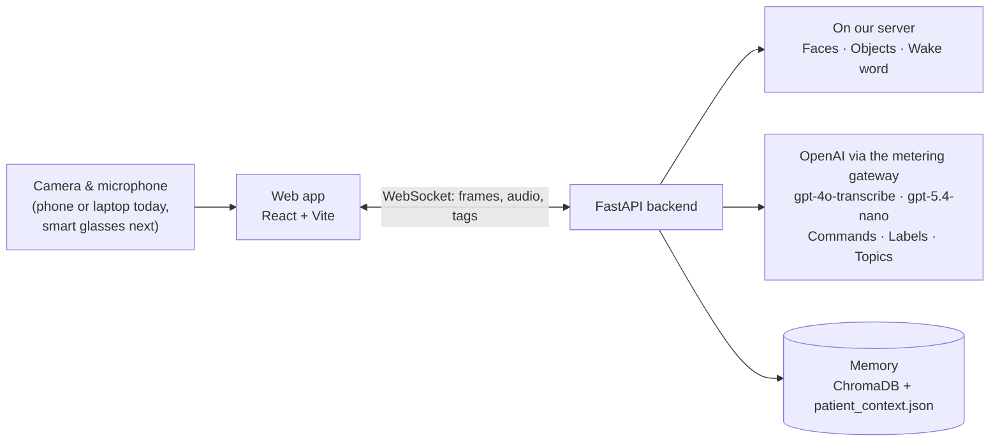
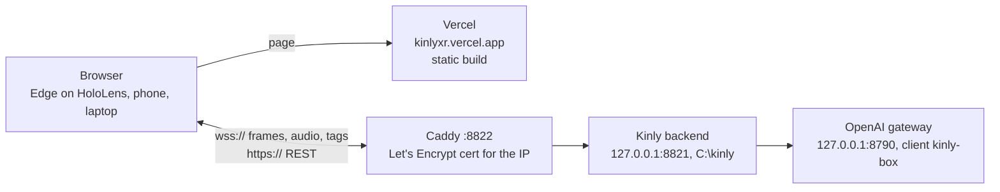

<p align="center">
  
</p>

<h1 align="center">Kinly</h1>

<p align="center">
  <b>An ambient memory companion for people living with memory loss.</b><br>
  <i>From “kin” — the people you love.</i>
</p>

<p align="center">
  Hackathon prototype · HackYeah 2026
</p>

---

## Why Kinly

Around **57 million people** live with dementia worldwide, and nearly **10 million new cases** are added every year ([WHO](https://www.who.int/news-room/fact-sheets/detail/dementia)). In everyday life that means:

- **Faces** — not recognising friends and family.
- **Conversations** — forgetting what was said, sometimes minutes later.
- **Medicines** — mixing up boxes that look almost the same.

Most assistive tools expect the user to open an app, type or navigate menus — exactly what is hard for someone with memory loss. Kinly works the other way round: it runs quietly in the background and helps without being asked. The end goal is **smart glasses**; today's prototype is a **web app** that uses a phone or laptop camera.

**Who it's for:** people with early dementia or memory decline, and the families and caregivers who set up the people, objects and medicines for them.

## What it does

| | |
|---|---|
| **Recognises people** | Shows the name, relation and last conversation topic over each familiar face. |
| **Remembers conversations** | While a known person is in view, the conversation is collected; 20 s after they leave, it is transcribed and turned into a short topic saved for that person. Works in any language. |
| **Knows your things** | Show an object from three sides once (a guided 3 × 2-second capture) and it is recognised from then on — with your note, dosage and schedule. |
| **Keeps medicines apart** | Reads the name and dosage printed on the box and uses it to tell look-alike packages apart. If the label can't be confirmed, Kinly shows nothing rather than guess. |
| **“Hey Kinly”** | Say “Hey Kinly” (or “Remind me”), then speak naturally: save a note, set a reminder, remember the object you're holding, add a conversation topic, or ask a question. |
| **One place for everything** | The Memory Database lets the family view and edit people, topics, notes, objects, routines and reminders. |

### Two modes

- **Ambient mode** — always on: name tags over faces, tags over saved objects, automatic conversation topics, and a short description of the surroundings when they change.
- **Command mode** — opened by “Hey Kinly” or the button. Only what is inside the centre frame is recognised; click the screen to send your spoken command.

## Screenshots

<!-- Add the images to docs/images/ with these file names (see docs/images/README.md). -->

| | |
|---|---|
|  |  |
| **Command mode** — the centre frame and the object to save | **Saving an object** — three sides, a countdown for each |
|  |  |
| **Save panel** — photos, label text, name, dosage | **Memory Database** — people, topics, objects, reminders |
|  |  |
| **Medicine** — the right box, with your note and dosage | **Conversation topics** — saved automatically for each person |

## How it works



| Component | Model / tool | Notes |
|---|---|---|
| Face detection | YuNet (via DeepFace) | ~0.1 s per frame on CPU |
| Face identity | Facenet512 (DeepFace) | Voting over the nearest stored vectors; tracking smooths names between frames |
| Wake word | Faster-Whisper `base` (int8) | Runs offline in its own process, with a “Kinly” hint so the name is heard correctly |
| Object detection | YOLOE-26s (open vocabulary) | A household word list, extended with the type of every saved object |
| Object identity | DINOv2-small | Each saved photo is stored with mirrored, brighter, darker and blurred variants |
| Speech to text for commands and conversation topics | gpt-4o-transcribe (OpenAI) | A conversation's 1.5 s chunks are joined into one WAV, so it is one call |
| Commands, label reading, conversation topics, scene descriptions | gpt-5.4-nano (OpenAI) | Strict JSON schema output, reasoning effort `none`; models can be changed with `KINLY_CHAT_MODEL`, `KINLY_STT_MODEL`, `KINLY_REASONING_EFFORT` |
| Spoken replies | Edge-TTS | |
| Memory | ChromaDB + `patient_context.json` | Vectors for faces and objects; notes, reminders, routines, objects and topics as JSON |

### Privacy

- **Stays on our server:** face and object recognition, and listening for the wake word.
- **Sent to OpenAI (through the owner's metering gateway):** spoken commands, photos of saved objects when reading labels, a camera frame every ~30 s for the surroundings description (only when the scene has changed), and conversation audio with known people — the last one can be turned off in **Settings → Save conversation topics automatically**.
- **Sent to Microsoft Edge TTS:** the text of spoken replies.

## Live: Vercel page + backend on the Hetzner box

Since 30.10.2026 Kinly runs on the internet, so it opens in Edge on HoloLens 2 (or any phone or laptop browser) by
a link: **https://kinlyxr.vercel.app**. Allow camera and microphone when the browser asks.



- **Page:** Vercel project `kinly` (scope `denis-projects-1d8d12e3`), a static build of `frontend/` made with
  `frontend/.env.vercel`, which points it at the box. `kinly.vercel.app` belongs to someone else, hence `kinlyxr`.
- **Backend:** Windows box `95.217.106.60`, folder `C:\kinly`. uvicorn listens on `127.0.0.1:8821` only; Caddy
  publishes it as `https://95.217.106.60:8822` and `wss://95.217.106.60:8822/ws/stream`. The page talks to the box
  directly: camera frames (960×540 every 300 ms) and audio go over a WebSocket, which a Vercel function cannot proxy,
  and a browser refuses a WebSocket to a self-signed certificate, so the certificate is a real one for the IP
  (Let's Encrypt short-lived profile, ~6 days, Caddy renews it over TLS-ALPN on port 443, which it opens only for
  those seconds). Firewall rule `kinly 8822`.
- **Scheduled tasks** (SYSTEM, no time limit): `kinly-backend` and `kinly-caddy` at startup, each restarting its
  process 10 s after an exit; `kinly-install` on demand. Logs: `C:\kinly\logs\backend.log`, `caddy.log`,
  `install.log`. Models download on the first start into `C:\kinly\cache` and `C:\kinly\backend`.
- **OpenAI:** gateway client `kinly-box`; its token is written into `C:\kinly\backend\.env` on the box by
  `install.bat` and never leaves it. The gateway's daily budget is shared with other jobs: when it is used up, commands,
  label reading, topics and scene descriptions fail (logged), while faces, objects and "Hey Kinly" keep working.
- **No access control** (owner's decision, 30.10.2026): whoever knows the backend address can read and change the
  memory database and spend the gateway budget.
- **No GPU** on the box: everything runs on CPU, as the original Docker setup does.

| Task | Command |
|---|---|
| Deploy the page | `./deploy/vercel/deploy.sh` |
| Send backend code to the box | `KINLY_BOX_KEY=<path to the box's ssh key> ./deploy/box/push.sh` |
| Restart the backend after a push | `ssh -i "$KINLY_BOX_KEY" Administrator@95.217.106.60 "powershell -NoProfile -ExecutionPolicy Bypass -File C:\kinly\deploy\restart.ps1"` |
| Install or update packages on the box | `./deploy/box/push.sh`, then `Start-ScheduledTask kinly-install` on the box, then restart |
| First install on a clean box | `./deploy/box/push.sh`, put Caddy 2.11+ at `C:\kinly\caddy\caddy.exe`, run `C:\kinly\deploy\setup.ps1`, wait for `install exit code 0` in `install.log`, `Start-ScheduledTask kinly-backend` and `kinly-caddy` |
| Check | `curl https://95.217.106.60:8822/docs` (200 once the models are loaded) |
| XR probe on the headset | https://kinlyxr.vercel.app/probe/ (`frontend/public/probe/index.html`; `/p` leads to the app itself since 30.10.2026): Start camera, then Enter VR; the panel in the room and `[Probe]` lines in `C:\kinly\logs\backend.log` show whether camera frames keep coming inside the immersive session and where name tags land |

The probe sends a frame counter `seq` with every `FRAME`; the backend echoes the counter of the frame it recognised in
`FACES`, so the page can place a tag using the head pose at the moment that frame was taken.

### AR mode on HoloLens 2 (30.10.2026)

**Enter AR** (top bar; shown wherever the browser has WebXR) takes the page into an immersive session
(`src/xr/KinlyAR.js`): there is no browser window, everything hangs in the room. Screens follow the owner's design v4
"Care AR" (RemindMe — glasses interface, https://claude.ai/artifact/7RYr9rYnxNXFEN3hqP1V2d): dark-green glass, solid
white text, mint accents, Atkinson Hyperlegible. Point with the hand ray (a light beam with a white ring at the end; the
button under it lights up) and pinch (air tap) to press.

| Screen (design v4) | What it does here |
|---|---|
| HUD | Date and time at the top edge of the view, follows the head (owner, 31.10.2026). Chips: walking, paused help, updates waiting for a pause in talk |
| Menu | Always on at the bottom edge of the view, follows the head (owner, 31.10.2026; the design summons it with a pinch): **What's here?**, **My memory**, **Speak**, **Pause help**, **Exit AR** (the last is not in the design) |
| Face tag | Known people up to 2 m away: initial and name only, a white line with a mint dot to the face. A pinch on the tag adds the relation, the last topic and **Forget** (asks first, then `DELETE /api/faces/{name}`); a pinch at nothing closes it (owner, 31.10.2026). Next to the face at face height, to its right (owner: above the head was too high) |
| Unknown person | A tag with **Add person** only after the camera has held that one face near the middle for 3 s (owner's choice; the design says "no dwell"). Add → say "Niaz, developer" (`POST /api/faces/introduce`) → **Yes, save** (`POST /api/faces`) |
| Walking | Head moving faster than 0.5 m/s for 1.5 s: everything hides except the HUD and the menu ("Walking — screen kept clear") |
| What's here? | The backend's command mode finds the object in the middle; mint frame on it and a card "This looks like a …" with **Save** / **Not now**. Save takes three photos while you turn it, reads the label (`/api/objects/prepare`), then Step 1 "Is this your medicine?" and Step 2 name, dosage, note with **Yes, save** / **Change it** (say "Amoxiclav, 3 times a day", `POST /api/objects/introduce`) |
| Saved objects | Recognised saved objects get the frame and a card at the object (name, dosage or note) |
| Speak | Say a request as with "Hey Kinly" (note, reminder, question, topic); the answer is shown and said aloud |
| My memory | A board where you looked, between the HUD and the menu: people and objects from the database (first four, "+ N more") and **Close** |
| Saved | "Saved …" and "Topic saved …" wait until you have been quiet for 1.5 s (microphone level), then show under the HUD with a soft chime |

- Every 3 s the AR mode writes its state to `C:\kinly\logs\backend.log` as a `[Probe]` line with `"app": "kinly-ar"`:
  microphone, hands, taps and hits, the open card and its text, the opened tag, board, walking, paused, waiting updates, tags,
  objects, errors.
- How it works: WebXR gives the headset browser no camera image, so the page keeps its ordinary camera stream, sends
  frames with `seq` from the XR loop (the 2D loop pauses), keeps the head pose of each, and puts a tag on the ray through
  the face or object — direction from its place in the frame, distance from its width (a face ~15 cm, a held object
  ~12 cm). The backend echoes `seq` in FACES and OBJECTS. Tune from the link without a new build: `?hfov=` (camera field
  of view, default 64.7°), `?facew=` (0.15 m), `?objw=` (0.12 m), `?maxdist=` (people farther get no tag, 2 m),
  `?hudup=` / `?menudown=` (HUD and menu, degrees above / below the middle of the view, 10 each).
- The person-out-of-view arrow of the design was removed (owner, 31.10.2026: it overloaded the view).
- A red panel of frame timings in the headset is the OpenXR frame timing overlay, not the page: it is switched off in
  the OpenXR Tools for Windows Mixed Reality app (Settings → Display frame timing overlay) or in Device Portal → OpenXR.
- Session settings are the ones that start on this headset: WebGL 1, `immersive-vr` (the display is additive, so it is
  AR), `local` space, no hand tracking; hands arrive as `tracked-pointer` rays.
- Not in this version: the design's "say a button's name" (buttons are pressed with a pinch only) and a memory board that
  stays on the wall between sessions (it stays where it opened until closed).

`deploy.sh` deploys the build from a folder outside git: the Vercel CLI attaches the HEAD commit's author, and a
production deploy is blocked when that author has no Vercel account (this repository's history has such authors).

## Run locally on a Mac (no Docker)

```bash
cd backend && uv sync
```

```bash
cd frontend && npm ci
```

`backend/.env` needs the OpenAI gateway pair: `OPENAI_BASE_URL` (the gateway, `http://127.0.0.1:8790/v1`) and
`OPENAI_API_KEY` (this client's gateway token, issued by the gateway's `gw_client_env.py`, client `kinly-mac`). The
backend reads the pair from this file only, never from the shell environment. Then start the backend
(`uv run uvicorn main:app --port 8000` in `backend/`) and the frontend (`npm run dev` in `frontend/`) and open
http://localhost:5173.

## Getting started with Docker (the original setup)

Tested on **Windows 11 with Docker Desktop**.

**Requirements:** Docker Desktop (running) and the OpenAI gateway settings in `backend/.env` (see above). A Hugging
Face token is not needed.

1. **Add the gateway settings.** In PowerShell, in the project folder (Docker reaches the host's gateway at
   `host.docker.internal`; this path is not tested since the move from Gemini to OpenAI on 30.10.2026):
   ```powershell
   Set-Content -Path backend\.env -Value "OPENAI_BASE_URL=http://host.docker.internal:8790/v1","OPENAI_API_KEY=your-gateway-token" -Encoding ascii
   ```
   Use this command rather than `echo ... > .env` — Windows PowerShell writes `echo` output in an encoding the backend can't read.

2. **Start the app:**
   ```powershell
   docker compose -f docker-compose.dev.yml up -d --build
   ```
   The first build downloads several GB and takes 10–20 minutes; the first start then downloads the AI models (a few more minutes). Later starts take about a minute.

3. **Wait for the backend:**
   ```powershell
   docker logs -f remindme-backend-dev
   ```
   Wait for `Application startup complete`, then press Ctrl+C.

4. **Open http://localhost:5173** in Chrome or Edge and allow camera and microphone access. Turn the microphone on (button on the right of the bottom bar) to use “Hey Kinly”.

| Task | Command |
|---|---|
| Start | `docker compose -f docker-compose.dev.yml up -d` |
| Stop | `docker compose -f docker-compose.dev.yml down` |
| Restart the backend | `docker compose -f docker-compose.dev.yml restart backend` |
| Backend logs | `docker logs -f remindme-backend-dev` |
| Check the backend | open http://localhost:8000/docs |

### Using an Android phone

With the phone connected by USB (USB debugging on), forward the ports and open the app in Chrome on the phone:

```powershell
adb reverse tcp:5173 tcp:5173
adb reverse tcp:8000 tcp:8000
```

Then go to **http://localhost:5173** on the phone. Everything still runs on the laptop; the phone is the camera, microphone and screen.

### Moving to another computer

The face and object vectors live in a Docker volume, not in git. On a new computer the people and objects listed in `patient_context.json` appear, but must be added again to be recognised.

## Project structure

```
kinly/
├── backend/
│   ├── main.py               # FastAPI app: WebSocket stream, modes, conversation topics, REST API
│   ├── face_processor.py     # Face detection + identity, frame-to-frame tracking
│   ├── object_processor.py   # YOLOE detection, DINOv2 matching, guided capture, label matching
│   ├── audio_processor.py    # "Hey Kinly" wake-word detection
│   ├── whisper_worker.py     # Whisper in its own process
│   ├── llm_orchestrator.py   # OpenAI via the gateway: commands, label reading, conversation topics, scene descriptions
│   ├── db.py                 # ChromaDB collections + patient_context.json
│   └── patient_context.json  # Notes, reminders, routines, objects, conversation topics
├── frontend/
│   ├── src/App.jsx                       # Camera, WebSocket, modes, tags, object capture
│   ├── src/components/DatabasePanel.jsx  # Memory Database
│   ├── src/xr/KinlyAR.js                 # AR mode for HoloLens 2: tags in the room, add a person by voice
│   ├── src/components/KinlyLogo.jsx      # Logo
│   └── public/favicon.svg
├── deploy/box/               # Hetzner box: Caddyfile, run_backend.bat, run_caddy.bat, install.bat, setup.ps1, restart.ps1, push.sh
├── deploy/vercel/            # Vercel: deploy.sh, vercel.json, project.json (ids of the project kinly)
├── frontend/.env.vercel      # Backend addresses baked into the Vercel build
├── docs/images/              # Screenshots used in this README
├── docker-compose.dev.yml    # Development setup (hot reload) — the tested way to run Kinly
└── docker-compose.yml        # Production setup (nginx) — not tested with the current version
```

## What's next

- **Smart glasses** — run Kinly on glasses, with hints right in the field of view.
- **Caregiver dashboard** — family adds people, objects and medicines remotely.
- **Safety mode** — notice disorientation and alert a caregiver.
- **Full offline operation** — no cloud AI needed.

<p align="center"><i>Because no one should forget alone.</i></p>
